# Salut, moi c'est Mamary Diawara 👋

> Étudiant en **Licence 3 Intelligence Artificielle** à l'**Université Internationale Privée d'Excellence (UIE)**, passionné par le développement d'IA et le Machine Learning, et activement en apprentissage de la cybersécurité.

🎯 **Objectif :** À la recherche d'un **stage en Intelligence Artificielle / Machine Learning / Cybersécurité** [période / durée souhaitée, ex: à partir de Mois Année].

---

### 👨‍💻 À propos de moi

- 🎓 Étudiant en Licence 3 IA à l'**UIE** (Université Internationale Privée d'Excellence).
- 🧠 Domaines de prédilection : Machine Learning, Développement IA et Analyse de données.
- 🛡️ En constante montée en compétences dans le domaine de la cybersécurité.
- 🗣️ **Langues :**
  - **Français :** Courant
  - **Anglais :** Intermédiaire (en progression)

---

### 🛠️ Compétences techniques

#### 🤖 Intelligence Artificielle & Data

#### 💻 Programmation & Données

#### ⚙️ Outils & Versioning

#### 📊 Bureautique Avancée

---

### 🛡️ En apprentissage

- 🔐 **Cybersécurité :** [Concepts clés étudiés, ex: sécurité réseau, cryptographie, analyse de vulnérabilités...]

---

### 🚀 Projets

<!-- Emplacements réservés pour vos projets personnels ou universitaires -->

#### 🔹 [Nom du projet 1]
- **Description :** [Courte description du projet et du problème résolu]
- **Technologies :** `[Ex: Python, Machine Learning]`
- **Lien :** [Voir le code source / dépôt](https://github.com/mamarydiawara24-sudo/[nom-du-depot])

#### 🔹 [Nom du projet 2]
- **Description :** [Courte description du projet]
- **Technologies :** `[Ex: Java, SQL]`
- **Lien :** [Voir le code source / dépôt](https://github.com/mamarydiawara24-sudo/[nom-du-depot])

---

### 🐍 GitHub Contribution Snake

<picture>
  <source media="(prefers-color-scheme: dark)" srcset="https://raw.githubusercontent.com/mamarydiawara24-sudo/mamarydiawara24-sudo/output/github-contribution-grid-snake-dark.svg">
  <source media="(prefers-color-scheme: light)" srcset="https://raw.githubusercontent.com/mamarydiawara24-sudo/mamarydiawara24-sudo/output/github-contribution-grid-snake.svg">
  
</picture>

---

### 📬 Me contacter

- 💼 **LinkedIn :** [[Lien vers votre profil LinkedIn]]
- 📧 **Email :** [mamarydiawara24@gmail.com]
- 🐙 **GitHub :** [@mamarydiawara24-sudo](https://github.com/mamarydiawara24-sudo)
